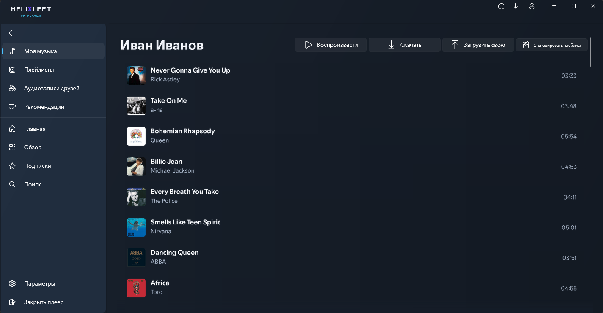
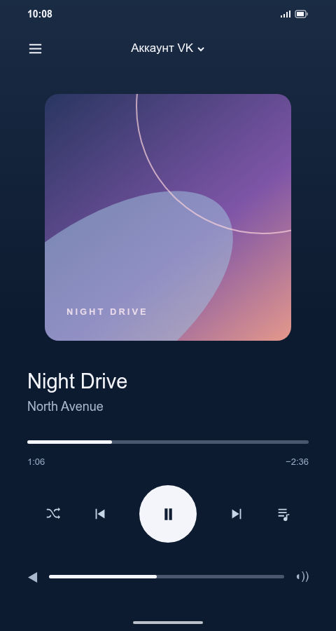

# HXLT Player

Закрывает базовые нужны для прослушивания VK музыки и немного узконаправленных QoL. 

- Удобная авторизация и сопряжение с приложением на ПК.
- Управление плеером на ПК с телефона.
- Незначительное потребление RAM. 

## Интерфейс

**Windows**

**Android**

Windows — обработанный скриншот; Android — визуальный макет.
