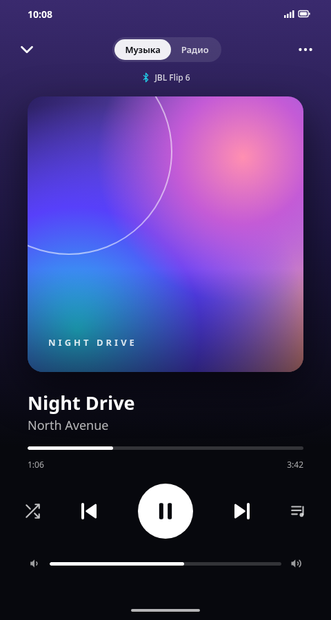

# HXLT Player

Закрывает базовые нужны для прослушивания VK музыки и немного узконаправленных QoL. 

- Удобная авторизация и сопряжение с приложением на ПК.
- Управление плеером на ПК с телефона.
- Незначительное потребление RAM. 
- Android в двух вариантах: обычный и Modern с новым интерфейсом. Ставятся рядом и не мешают друг другу.

## Интерфейс

**Windows**

<table>
  <tr>
    <th>Android</th>
    <th>Android Modern</th>
  </tr>
  <tr>
    <td></td>
    <td></td>
  </tr>
  <tr>
    <td align="center"><a href="https://github.com/Helixleet/HXLT-builds/releases/latest/download/HXLT_Player.apk">HXLT_Player.apk</a></td>
    <td align="center"><a href="https://github.com/Helixleet/HXLT-builds/releases/latest/download/HXLT_Player_modern.apk">HXLT_Player_modern.apk</a></td>
  </tr>
</table>

Windows — обработанный скриншот; Android и Android Modern — визуальные макеты.
